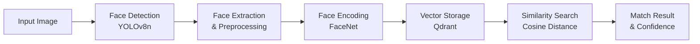

# 4. Thuật Toán và Trí Tuệ Nhân Tạo

## 4.1 Tổng Quan AI Pipeline

Hệ thống sử dụng một pipeline AI phức tạp kết hợp nhiều thuật toán machine learning và computer vision để thực hiện nhận diện khuôn mặt chính xác và nhanh chóng.



## 4.2 Face Detection - YOLOv8n

### 4.2.1 Thuật Toán YOLO (You Only Look Once)

**Nguyên lý hoạt động**:
- YOLO chia ảnh thành lưới SxS cells
- Mỗi cell dự đoán B bounding boxes và confidence scores
- Sử dụng Non-Maximum Suppression (NMS) để loại bỏ duplicate detections

**YOLOv8n Architecture**:
```python
# YOLOv8n Model Architecture
Input: RGB Image (640x640 default)
├── Backbone: CSPDarknet53-nano
│   ├── Conv2d + BatchNorm + SiLU activation
│   ├── C2f blocks (Cross Stage Partial with 2 convolutions)
│   └── SPPF (Spatial Pyramid Pooling Fast)
├── Neck: PAN (Path Aggregation Network)
│   ├── Feature Pyramid Network (FPN)
│   └── Bottom-up path augmentation
└── Head: Decoupled detection head
    ├── Classification branch
    ├── Regression branch (bbox coordinates)
    └── Objectness branch
```

### 4.2.2 Implementation Details

```python
class FaceDetector:
    def __init__(self, model_path: str = "yolov8n.pt", confidence_threshold: float = 0.5):
        """
        Initialize YOLOv8n face detector
        
        Args:
            model_path: Path to YOLOv8n model weights
            confidence_threshold: Minimum confidence for detection
        """
        self.model = YOLO(model_path)
        self.confidence_threshold = confidence_threshold
        self.target_classes = [0]  # Person class in COCO dataset
    
    def detect_faces(self, image: np.ndarray) -> List[BoundingBox]:
        """
        Detect faces in image using YOLOv8n
        
        Process:
        1. Preprocess image (resize, normalize)
        2. Run inference through YOLOv8n
        3. Post-process results (NMS, filtering)
        4. Extract face regions with padding
        
        Args:
            image: Input RGB image array
            
        Returns:
            List of BoundingBox objects with coordinates and confidence
        """
        
        # 1. Preprocessing
        processed_image = self._preprocess_image(image)
        
        # 2. Inference
        results = self.model(processed_image, verbose=False)
        
        # 3. Post-processing
        detections = []
        for result in results:
            boxes = result.boxes
            if boxes is not None:
                for box in boxes:
                    # Filter by class (person) and confidence
                    if (int(box.cls) in self.target_classes and 
                        float(box.conf) >= self.confidence_threshold):
                        
                        # Extract coordinates
                        x1, y1, x2, y2 = box.xyxy[0].cpu().numpy()
                        confidence = float(box.conf)
                        
                        # Create bounding box with padding for face region
                        face_bbox = self._extract_face_region(
                            x1, y1, x2, y2, confidence, image.shape
                        )
                        detections.append(face_bbox)
        
        return detections
    
    def _extract_face_region(self, x1: float, y1: float, x2: float, y2: float, 
                           confidence: float, image_shape: tuple) -> BoundingBox:
        """
        Extract face region from person detection with intelligent cropping
        
        Assumptions:
        - Face is typically in upper 1/3 of person bounding box
        - Face width is approximately 1/3 of person width
        - Add padding for better face encoding
        """
        
        person_width = x2 - x1
        person_height = y2 - y1
        
        # Estimate face region (upper portion of person detection)
        face_width = person_width * 0.4  # Face is ~40% of person width
        face_height = person_height * 0.3  # Face is ~30% of person height
        
        # Center face horizontally, position in upper portion
        face_x1 = x1 + (person_width - face_width) / 2
        face_y1 = y1 + person_height * 0.1  # Start at 10% from top
        face_x2 = face_x1 + face_width
        face_y2 = face_y1 + face_height
        
        # Add padding (20% on each side)
        padding_x = face_width * 0.2
        padding_y = face_height * 0.2
        
        face_x1 = max(0, face_x1 - padding_x)
        face_y1 = max(0, face_y1 - padding_y)
        face_x2 = min(image_shape[1], face_x2 + padding_x)
        face_y2 = min(image_shape[0], face_y2 + padding_y)
        
        return BoundingBox(face_x1, face_y1, face_x2, face_y2, confidence)
```

### 4.2.3 Performance Optimization

```python
# YOLOv8n Performance Optimizations
class YOLOOptimization:
    
    def optimize_inference(self):
        """Various optimization techniques"""
        
        # 1. Model Quantization (INT8)
        self.model.export(format="onnx", int8=True)
        
        # 2. TensorRT Optimization (GPU)
        self.model.export(format="engine", device=0)
        
        # 3. Batch Processing
        def batch_detect(self, images: List[np.ndarray]) -> List[List[BoundingBox]]:
            batch_results = self.model(images, stream=True)
            return [self._process_result(result) for result in batch_results]
        
        # 4. Input Resolution Optimization
        # Trade-off between speed and accuracy
        resolutions = {
            "fast": 320,      # ~50 FPS, lower accuracy
            "balanced": 640,  # ~20 FPS, good accuracy  
            "accurate": 1280  # ~5 FPS, high accuracy
        }
```

## 4.3 Face Encoding - FaceNet

### 4.3.1 FaceNet Architecture

**Model**: InceptionResnetV1 với VGGFace2 pre-training

```python
# FaceNet Architecture Overview
InceptionResnetV1:
├── Stem: Initial convolution layers
├── Inception-ResNet-A blocks (5x)
├── Reduction-A: Dimensionality reduction
├── Inception-ResNet-B blocks (10x) 
├── Reduction-B: Dimensionality reduction
├── Inception-ResNet-C blocks (5x)
├── Average Pooling: Global average pooling
└── Linear: 512-dimensional embedding

Total Parameters: ~23M
Output: 512-dimensional L2-normalized vector
```

### 4.3.2 Face Preprocessing Pipeline

```python
class FacePreprocessor:
    def __init__(self, target_size: int = 160):
        """
        Initialize face preprocessor for FaceNet
        
        Args:
            target_size: Target face size (160x160 for FaceNet)
        """
        self.target_size = target_size
        
    def preprocess_face(self, face_image: np.ndarray) -> torch.Tensor:
        """
        Preprocess face for FaceNet encoding
        
        Steps:
        1. Resize to 160x160 (FaceNet input size)
        2. Normalize pixel values to [-1, 1]
        3. Convert to tensor format
        4. Add batch dimension
        
        Args:
            face_image: Face crop as numpy array (RGB)
            
        Returns:
            Preprocessed tensor ready for FaceNet
        """
        
        # 1. Convert to PIL Image for high-quality resizing
        if isinstance(face_image, np.ndarray):
            pil_image = Image.fromarray(face_image.astype('uint8'))
        else:
            pil_image = face_image
        
        # 2. Resize using LANCZOS interpolation (high quality)
        resized = pil_image.resize(
            (self.target_size, self.target_size), 
            Image.Resampling.LANCZOS
        )
        
        # 3. Convert back to numpy array
        face_array = np.array(resized).astype(np.float32)
        
        # 4. Normalize to [-1, 1] range (FaceNet standard)
        normalized = (face_array - 127.5) / 128.0
        
        # 5. Convert to PyTorch tensor (CHW format)
        tensor = torch.from_numpy(normalized).permute(2, 0, 1)
        
        # 6. Add batch dimension
        batch_tensor = tensor.unsqueeze(0)
        
        return batch_tensor
```

### 4.3.3 Face Encoding Implementation

```python
class FaceEncoder:
    def __init__(self, device: str = "cpu"):
        """
        Initialize FaceNet encoder
        
        Args:
            device: Computing device (cpu/cuda)
        """
        self.device = torch.device(device)
        self.model = InceptionResnetV1(pretrained='vggface2').eval()
        self.model.to(self.device)
        self.preprocessor = FacePreprocessor()
        
    def encode_face(self, face_image: np.ndarray) -> np.ndarray:
        """
        Encode face to 512-dimensional vector
        
        Args:
            face_image: Face crop as RGB numpy array
            
        Returns:
            512-dimensional L2-normalized embedding vector
        """
        
        # 1. Preprocess face image
        face_tensor = self.preprocessor.preprocess_face(face_image)
        face_tensor = face_tensor.to(self.device)
        
        # 2. Generate embedding
        with torch.no_grad():
            embedding = self.model(face_tensor)
            
            # 3. L2 normalization (crucial for cosine similarity)
            normalized_embedding = F.normalize(embedding, p=2, dim=1)
            
            # 4. Convert to numpy array
            face_vector = normalized_embedding.cpu().numpy().flatten()
        
        return face_vector
    
    def batch_encode_faces(self, face_images: List[np.ndarray]) -> np.ndarray:
        """
        Batch encoding for multiple faces (more efficient)
        
        Args:
            face_images: List of face crops
            
        Returns:
            Array of shape (N, 512) with N face embeddings
        """
        
        # 1. Preprocess all faces
        face_tensors = []
        for face_image in face_images:
            tensor = self.preprocessor.preprocess_face(face_image)
            face_tensors.append(tensor)
        
        # 2. Stack into batch
        batch_tensor = torch.cat(face_tensors, dim=0).to(self.device)
        
        # 3. Batch inference
        with torch.no_grad():
            embeddings = self.model(batch_tensor)
            normalized_embeddings = F.normalize(embeddings, p=2, dim=1)
            face_vectors = normalized_embeddings.cpu().numpy()
        
        return face_vectors
```

### 4.3.4 Embedding Quality Assessment

```python
class EmbeddingQualityAssessment:
    def __init__(self):
        self.quality_thresholds = {
            "excellent": 0.95,
            "good": 0.85,
            "acceptable": 0.75,
            "poor": 0.60
        }
    
    def assess_embedding_quality(self, face_image: np.ndarray, 
                               embedding: np.ndarray) -> dict:
        """
        Assess quality of face embedding
        
        Factors:
        1. Face image quality (brightness, contrast, sharpness)
        2. Embedding magnitude consistency
        3. Embedding distribution analysis
        
        Args:
            face_image: Original face image
            embedding: Generated embedding vector
            
        Returns:
            Quality assessment report
        """
        
        # 1. Image quality metrics
        image_quality = self._assess_image_quality(face_image)
        
        # 2. Embedding consistency
        embedding_norm = np.linalg.norm(embedding)
        norm_consistency = abs(1.0 - embedding_norm)  # Should be ~1.0 after L2 norm
        
        # 3. Embedding distribution
        embedding_std = np.std(embedding)
        embedding_mean = np.mean(embedding)
        
        # 4. Overall quality score
        quality_score = (
            image_quality["overall"] * 0.4 +
            (1.0 - norm_consistency) * 0.3 +
            min(embedding_std / 0.3, 1.0) * 0.3  # Good embeddings have std ~0.2-0.3
        )
        
        # 5. Quality classification
        quality_level = "poor"
        for level, threshold in self.quality_thresholds.items():
            if quality_score >= threshold:
                quality_level = level
                break
        
        return {
            "quality_score": quality_score,
            "quality_level": quality_level,
            "image_quality": image_quality,
            "embedding_norm": embedding_norm,
            "embedding_std": embedding_std,
            "recommendations": self._get_quality_recommendations(quality_score, image_quality)
        }
    
    def _assess_image_quality(self, image: np.ndarray) -> dict:
        """Assess face image quality metrics"""
        
        # Convert to grayscale for some metrics
        gray = cv2.cvtColor(image, cv2.COLOR_RGB2GRAY)
        
        # 1. Brightness assessment
        brightness = np.mean(gray) / 255.0
        brightness_score = 1.0 - abs(brightness - 0.5) * 2  # Optimal around 0.5
        
        # 2. Contrast assessment  
        contrast = np.std(gray) / 255.0
        contrast_score = min(contrast / 0.2, 1.0)  # Good contrast > 0.2
        
        # 3. Sharpness assessment (Laplacian variance)
        laplacian_var = cv2.Laplacian(gray, cv2.CV_64F).var()
        sharpness_score = min(laplacian_var / 500.0, 1.0)  # Good sharpness > 500
        
        # 4. Overall image quality
        overall_quality = (brightness_score + contrast_score + sharpness_score) / 3.0
        
        return {
            "brightness": brightness_score,
            "contrast": contrast_score, 
            "sharpness": sharpness_score,
            "overall": overall_quality
        }
```

## 4.4 Similarity Search Algorithm

### 4.4.1 Cosine Similarity

**Mathematical Foundation**:
```python
# Cosine Similarity Formula
def cosine_similarity(vector_a: np.ndarray, vector_b: np.ndarray) -> float:
    """
    Calculate cosine similarity between two vectors
    
    Formula: cos(θ) = (A · B) / (||A|| × ||B||)
    
    For L2-normalized vectors: cos(θ) = A · B
    """
    
    # For L2-normalized vectors, cosine similarity = dot product
    if np.allclose(np.linalg.norm(vector_a), 1.0) and np.allclose(np.linalg.norm(vector_b), 1.0):
        return np.dot(vector_a, vector_b)
    
    # General case
    dot_product = np.dot(vector_a, vector_b)
    norm_a = np.linalg.norm(vector_a)
    norm_b = np.linalg.norm(vector_b)
    
    if norm_a == 0 or norm_b == 0:
        return 0.0
    
    return dot_product / (norm_a * norm_b)

# Similarity ranges:
# 1.0: Identical vectors
# 0.9-0.99: Very high similarity (same person, different conditions)
# 0.8-0.89: High similarity (likely same person)
# 0.7-0.79: Moderate similarity (possible match, needs verification)
# <0.7: Low similarity (likely different person)
```

### 4.4.2 Qdrant Vector Search Implementation

```python
class VectorSearchEngine:
    def __init__(self, qdrant_client, collection_name: str = "face_vectors"):
        self.client = qdrant_client
        self.collection_name = collection_name
        self.default_threshold = 0.8
        
    def search_similar_faces(self, query_vector: np.ndarray, 
                           limit: int = 10, 
                           threshold: float = None) -> List[dict]:
        """
        Search for similar face vectors using Qdrant
        
        Args:
            query_vector: 512-dimensional query embedding
            limit: Maximum number of results to return
            threshold: Minimum similarity threshold
            
        Returns:
            List of matches with scores and metadata
        """
        
        threshold = threshold or self.default_threshold
        
        # 1. Ensure vector is normalized
        if not np.allclose(np.linalg.norm(query_vector), 1.0):
            query_vector = query_vector / np.linalg.norm(query_vector)
        
        # 2. Perform vector search
        search_results = self.client.search(
            collection_name=self.collection_name,
            query_vector=query_vector.tolist(),
            limit=limit,
            score_threshold=threshold,
            with_payload=True,
            with_vectors=False  # Don't return vectors to save bandwidth
        )
        
        # 3. Process results
        matches = []
        for result in search_results:
            match = {
                "vector_id": result.id,
                "similarity_score": result.score,
                "user_id": result.payload.get("user_id"),
                "image_id": result.payload.get("image_id"),
                "created_at": result.payload.get("created_at"),
                "confidence_level": self._classify_confidence(result.score)
            }
            matches.append(match)
        
        return matches
    
    def _classify_confidence(self, similarity_score: float) -> str:
        """Classify confidence level based on similarity score"""
        
        if similarity_score >= 0.95:
            return "very_high"
        elif similarity_score >= 0.90:
            return "high"
        elif similarity_score >= 0.85:
            return "medium"
        elif similarity_score >= 0.80:
            return "low"
        else:
            return "very_low"
    
    def advanced_search(self, query_vector: np.ndarray, 
                       filters: dict = None,
                       boost_recent: bool = True) -> List[dict]:
        """
        Advanced search with filtering and boosting
        
        Args:
            query_vector: Query embedding
            filters: Metadata filters (user_id, date_range, etc.)
            boost_recent: Boost more recent embeddings
            
        Returns:
            Filtered and ranked search results
        """
        
        # 1. Build Qdrant filter
        qdrant_filter = None
        if filters:
            conditions = []
            
            if "user_ids" in filters:
                conditions.append({
                    "key": "user_id",
                    "match": {"any": filters["user_ids"]}
                })
            
            if "date_range" in filters:
                conditions.append({
                    "key": "created_at",
                    "range": {
                        "gte": filters["date_range"]["start"],
                        "lte": filters["date_range"]["end"]
                    }
                })
            
            if conditions:
                qdrant_filter = {"must": conditions}
        
        # 2. Perform filtered search
        search_results = self.client.search(
            collection_name=self.collection_name,
            query_vector=query_vector.tolist(),
            query_filter=qdrant_filter,
            limit=50,  # Get more results for post-processing
            score_threshold=0.7,  # Lower threshold for advanced processing
            with_payload=True
        )
        
        # 3. Post-process results
        processed_results = []
        for result in search_results:
            # Calculate boosted score
            boosted_score = result.score
            
            if boost_recent:
                # Boost recent embeddings (within last 30 days)
                created_at = datetime.fromisoformat(result.payload["created_at"])
                days_old = (datetime.utcnow() - created_at).days
                
                if days_old <= 30:
                    boost_factor = 1.0 + (30 - days_old) / 300.0  # Up to 10% boost
                    boosted_score = min(1.0, result.score * boost_factor)
            
            processed_results.append({
                "vector_id": result.id,
                "original_score": result.score,
                "boosted_score": boosted_score,
                "user_id": result.payload["user_id"],
                "image_id": result.payload["image_id"],
                "created_at": result.payload["created_at"]
            })
        
        # 4. Sort by boosted score and apply final threshold
        processed_results.sort(key=lambda x: x["boosted_score"], reverse=True)
        final_results = [r for r in processed_results if r["boosted_score"] >= self.default_threshold]
        
        return final_results[:10]  # Return top 10
```

## 4.5 Multi-Face Processing

### 4.5.1 Multiple Face Detection Strategy

```python
class MultiFaceProcessor:
    def __init__(self, face_detector: FaceDetector, face_encoder: FaceEncoder):
        self.face_detector = face_detector
        self.face_encoder = face_encoder
        self.max_faces_per_image = 10
        
    def process_multi_face_image(self, image: np.ndarray) -> dict:
        """
        Process image with multiple faces
        
        Strategy:
        1. Detect all faces in image
        2. Rank faces by size and quality
        3. Encode top N faces
        4. Search for each face separately
        5. Aggregate results with confidence weighting
        
        Args:
            image: Input image with potentially multiple faces
            
        Returns:
            Aggregated results with individual face analysis
        """
        
        # 1. Detect all faces
        face_detections = self.face_detector.detect_faces(image)
        
        if not face_detections:
            return {
                "faces_detected": 0,
                "matches": [],
                "message": "No faces detected in image"
            }
        
        # 2. Limit and rank faces
        if len(face_detections) > self.max_faces_per_image:
            # Sort by confidence and size
            face_detections.sort(
                key=lambda x: x.confidence * (x.width * x.height), 
                reverse=True
            )
            face_detections = face_detections[:self.max_faces_per_image]
        
        # 3. Process each face
        face_results = []
        for i, face_bbox in enumerate(face_detections):
            # Extract face region
            face_crop = self._extract_face_crop(image, face_bbox)
            
            # Assess face quality
            quality_assessment = self._assess_face_quality(face_crop)
            
            # Skip low-quality faces
            if quality_assessment["overall_quality"] < 0.5:
                continue
            
            # Encode face
            face_embedding = self.face_encoder.encode_face(face_crop)
            
            # Search for matches
            search_results = self.vector_search.search_similar_faces(
                face_embedding, limit=5, threshold=0.75
            )
            
            face_result = {
                "face_index": i,
                "bbox": {
                    "x1": face_bbox.x1, "y1": face_bbox.y1,
                    "x2": face_bbox.x2, "y2": face_bbox.y2
                },
                "detection_confidence": face_bbox.confidence,
                "quality_assessment": quality_assessment,
                "matches": search_results
            }
            face_results.append(face_result)
        
        # 4. Aggregate results
        aggregated_results = self._aggregate_multi_face_results(face_results)
        
        return {
            "faces_detected": len(face_detections),
            "faces_processed": len(face_results),
            "individual_faces": face_results,
            "aggregated_results": aggregated_results
        }
    
    def _aggregate_multi_face_results(self, face_results: List[dict]) -> dict:
        """
        Aggregate results from multiple faces in same image
        
        Strategy:
        1. Group matches by user_id
        2. Weight by face quality and detection confidence
        3. Calculate aggregate confidence score
        4. Return best overall match
        """
        
        user_matches = {}
        
        # Group matches by user_id
        for face_result in face_results:
            face_quality = face_result["quality_assessment"]["overall_quality"]
            detection_conf = face_result["detection_confidence"]
            
            for match in face_result["matches"]:
                user_id = match["user_id"]
                similarity_score = match["similarity_score"]
                
                # Calculate weighted score
                weight = face_quality * detection_conf
                weighted_score = similarity_score * weight
                
                if user_id not in user_matches:
                    user_matches[user_id] = {
                        "user_id": user_id,
                        "total_weighted_score": 0.0,
                        "total_weight": 0.0,
                        "face_count": 0,
                        "best_similarity": 0.0,
                        "matches": []
                    }
                
                user_matches[user_id]["total_weighted_score"] += weighted_score
                user_matches[user_id]["total_weight"] += weight
                user_matches[user_id]["face_count"] += 1
                user_matches[user_id]["best_similarity"] = max(
                    user_matches[user_id]["best_similarity"], 
                    similarity_score
                )
                user_matches[user_id]["matches"].append(match)
        
        # Calculate final scores and rank
        final_matches = []
        for user_match in user_matches.values():
            if user_match["total_weight"] > 0:
                # Average weighted score
                avg_weighted_score = (
                    user_match["total_weighted_score"] / user_match["total_weight"]
                )
                
                # Boost for multiple face matches
                multi_face_boost = min(1.1, 1.0 + (user_match["face_count"] - 1) * 0.05)
                
                final_score = min(1.0, avg_weighted_score * multi_face_boost)
                
                final_matches.append({
                    "user_id": user_match["user_id"],
                    "final_score": final_score,
                    "average_similarity": avg_weighted_score,
                    "best_similarity": user_match["best_similarity"],
                    "face_count": user_match["face_count"],
                    "confidence_level": self._classify_confidence(final_score)
                })
        
        # Sort by final score
        final_matches.sort(key=lambda x: x["final_score"], reverse=True)
        
        return {
            "best_match": final_matches[0] if final_matches else None,
            "all_matches": final_matches,
            "total_candidates": len(user_matches)
        }
```

## 4.6 Performance Optimization Strategies

### 4.6.1 Model Optimization

```python
class ModelOptimization:
    
    def optimize_yolo_model(self):
        """Optimize YOLOv8n for production"""
        
        # 1. Model Quantization (INT8)
        quantized_model = torch.quantization.quantize_dynamic(
            self.yolo_model, 
            {torch.nn.Linear, torch.nn.Conv2d}, 
            dtype=torch.qint8
        )
        
        # 2. TorchScript Compilation
        scripted_model = torch.jit.script(quantized_model)
        
        # 3. ONNX Export for cross-platform deployment
        torch.onnx.export(
            self.yolo_model,
            dummy_input,
            "yolov8n_optimized.onnx",
            opset_version=11,
            do_constant_folding=True
        )
        
        return scripted_model
    
    def optimize_facenet_model(self):
        """Optimize FaceNet for production"""
        
        # 1. Half precision (FP16) for GPU
        if torch.cuda.is_available():
            self.facenet_model = self.facenet_model.half()
        
        # 2. Batch processing optimization
        def batch_encode_optimized(self, face_crops: List[np.ndarray]) -> np.ndarray:
            # Optimal batch size for memory/speed trade-off
            optimal_batch_size = 32
            
            all_embeddings = []
            for i in range(0, len(face_crops), optimal_batch_size):
                batch = face_crops[i:i + optimal_batch_size]
                batch_embeddings = self._encode_batch(batch)
                all_embeddings.append(batch_embeddings)
            
            return np.vstack(all_embeddings)
        
        # 3. Model pruning (remove less important weights)
        pruned_model = self._prune_model(self.facenet_model, sparsity=0.1)
        
        return pruned_model
```

### 4.6.2 Caching Strategies

```python
class AIModelCache:
    def __init__(self, cache_size: int = 1000):
        self.embedding_cache = LRUCache(cache_size)
        self.detection_cache = LRUCache(cache_size // 2)
        
    def get_cached_embedding(self, image_hash: str) -> Optional[np.ndarray]:
        """Get cached face embedding"""
        return self.embedding_cache.get(image_hash)
    
    def cache_embedding(self, image_hash: str, embedding: np.ndarray):
        """Cache face embedding"""
        self.embedding_cache.put(image_hash, embedding)
    
    def get_image_hash(self, image: np.ndarray) -> str:
        """Generate hash for image caching"""
        return hashlib.md5(image.tobytes()).hexdigest()
    
    @lru_cache(maxsize=500)
    def cached_similarity_search(self, embedding_tuple: tuple, threshold: float) -> tuple:
        """Cache similarity search results"""
        embedding = np.array(embedding_tuple)
        results = self.vector_search.search_similar_faces(embedding, threshold=threshold)
        return tuple(results)  # Convert to tuple for caching
```

## 4.7 Error Handling và Fallback Strategies

### 4.7.1 AI Model Error Handling

```python
class AIErrorHandler:
    def __init__(self):
        self.fallback_strategies = {
            "face_detection_failed": self._fallback_face_detection,
            "face_encoding_failed": self._fallback_face_encoding,
            "similarity_search_failed": self._fallback_similarity_search
        }
    
    def handle_detection_error(self, image: np.ndarray, error: Exception) -> List[BoundingBox]:
        """Handle face detection errors with fallbacks"""
        
        try:
            # Fallback 1: Try with different image preprocessing
            processed_image = self._enhance_image_for_detection(image)
            return self.face_detector.detect_faces(processed_image)
            
        except Exception as e1:
            try:
                # Fallback 2: Use alternative detection method
                return self._alternative_face_detection(image)
                
            except Exception as e2:
                # Fallback 3: Manual face region estimation
                return self._estimate_face_region(image)
    
    def handle_encoding_error(self, face_crop: np.ndarray, error: Exception) -> np.ndarray:
        """Handle face encoding errors"""
        
        try:
            # Fallback 1: Enhance face image quality
            enhanced_face = self._enhance_face_quality(face_crop)
            return self.face_encoder.encode_face(enhanced_face)
            
        except Exception as e1:
            try:
                # Fallback 2: Use different preprocessing
                alt_processed = self._alternative_preprocessing(face_crop)
                return self.face_encoder.encode_face(alt_processed)
                
            except Exception as e2:
                # Fallback 3: Return zero vector (will not match anything)
                logger.error(f"Face encoding completely failed: {e2}")
                return np.zeros(512)
    
    def _enhance_image_for_detection(self, image: np.ndarray) -> np.ndarray:
        """Enhance image to improve face detection"""
        
        # 1. Histogram equalization
        enhanced = cv2.equalizeHist(cv2.cvtColor(image, cv2.COLOR_RGB2GRAY))
        enhanced = cv2.cvtColor(enhanced, cv2.COLOR_GRAY2RGB)
        
        # 2. Noise reduction
        denoised = cv2.bilateralFilter(enhanced, 9, 75, 75)
        
        # 3. Sharpening
        kernel = np.array([[-1,-1,-1], [-1,9,-1], [-1,-1,-1]])
        sharpened = cv2.filter2D(denoised, -1, kernel)
        
        return sharpened
```

## 4.8 Accuracy Metrics và Evaluation

### 4.8.1 Model Performance Metrics

```python
class ModelEvaluator:
    def __init__(self):
        self.metrics = {
            "face_detection": {
                "precision": 0.0,
                "recall": 0.0,
                "f1_score": 0.0,
                "mAP": 0.0
            },
            "face_recognition": {
                "accuracy": 0.0,
                "far": 0.0,  # False Acceptance Rate
                "frr": 0.0,  # False Rejection Rate
                "eer": 0.0   # Equal Error Rate
            }
        }
    
    def evaluate_face_detection(self, test_images: List[np.ndarray], 
                              ground_truth: List[List[BoundingBox]]) -> dict:
        """Evaluate face detection performance"""
        
        total_tp = 0  # True Positives
        total_fp = 0  # False Positives
        total_fn = 0  # False Negatives
        
        for image, gt_boxes in zip(test_images, ground_truth):
            # Get predictions
            pred_boxes = self.face_detector.detect_faces(image)
            
            # Calculate IoU and match predictions to ground truth
            tp, fp, fn = self._calculate_detection_metrics(pred_boxes, gt_boxes)
            
            total_tp += tp
            total_fp += fp
            total_fn += fn
        
        # Calculate metrics
        precision = total_tp / (total_tp + total_fp) if (total_tp + total_fp) > 0 else 0
        recall = total_tp / (total_tp + total_fn) if (total_tp + total_fn) > 0 else 0
        f1_score = 2 * (precision * recall) / (precision + recall) if (precision + recall) > 0 else 0
        
        return {
            "precision": precision,
            "recall": recall,
            "f1_score": f1_score,
            "total_detections": total_tp + total_fp,
            "total_ground_truth": total_tp + total_fn
        }
    
    def evaluate_face_recognition(self, test_pairs: List[tuple], 
                                labels: List[bool]) -> dict:
        """Evaluate face recognition performance"""
        
        similarities = []
        
        # Calculate similarities for all test pairs
        for face1, face2 in test_pairs:
            embedding1 = self.face_encoder.encode_face(face1)
            embedding2 = self.face_encoder.encode_face(face2)
            similarity = cosine_similarity(embedding1, embedding2)
            similarities.append(similarity)
        
        # Calculate metrics at different thresholds
        thresholds = np.arange(0.1, 1.0, 0.01)
        far_rates = []
        frr_rates = []
        
        for threshold in thresholds:
            predictions = [sim >= threshold for sim in similarities]
            
            # Calculate FAR and FRR
            far = self._calculate_far(predictions, labels)
            frr = self._calculate_frr(predictions, labels)
            
            far_rates.append(far)
            frr_rates.append(frr)
        
        # Find Equal Error Rate (EER)
        eer_idx = np.argmin(np.abs(np.array(far_rates) - np.array(frr_rates)))
        eer = (far_rates[eer_idx] + frr_rates[eer_idx]) / 2
        eer_threshold = thresholds[eer_idx]
        
        # Calculate accuracy at optimal threshold
        optimal_predictions = [sim >= eer_threshold for sim in similarities]
        accuracy = np.mean([pred == label for pred, label in zip(optimal_predictions, labels)])
        
        return {
            "accuracy": accuracy,
            "eer": eer,
            "eer_threshold": eer_threshold,
            "far_at_eer": far_rates[eer_idx],
            "frr_at_eer": frr_rates[eer_idx],
            "roc_curve": {
                "thresholds": thresholds.tolist(),
                "far_rates": far_rates,
                "frr_rates": frr_rates
            }
        }
```

## 4.9 Kết Luận

Hệ thống AI của Face Attendance System được xây dựng trên nền tảng các thuật toán state-of-the-art:

### 4.9.1 Điểm Mạnh
1. **Độ chính xác cao**: FaceNet đạt >99% accuracy trên LFW dataset
2. **Tốc độ xử lý nhanh**: YOLOv8n tối ưu cho real-time processing
3. **Khả năng mở rộng**: Vector search với Qdrant HNSW index
4. **Robust error handling**: Multiple fallback strategies
5. **Quality assessment**: Tự động đánh giá chất lượng embedding

### 4.9.2 Tối Ưu Hóa
1. **Model optimization**: Quantization, pruning, TensorRT
2. **Caching strategies**: Multi-level caching cho embeddings
3. **Batch processing**: Tối ưu throughput
4. **Hardware acceleration**: GPU support cho production

### 4.9.3 Khả Năng Mở Rộng
1. **Model updates**: Dễ dàng thay thế models mới hơn
2. **Multi-modal**: Có thể mở rộng sang voice, gait recognition
3. **Edge deployment**: Tối ưu cho mobile và edge devices
4. **Federated learning**: Training phân tán bảo vệ privacy

Kiến trúc AI này đảm bảo hệ thống có thể đáp ứng yêu cầu production với độ chính xác cao, tốc độ nhanh và khả năng mở rộng tốt.