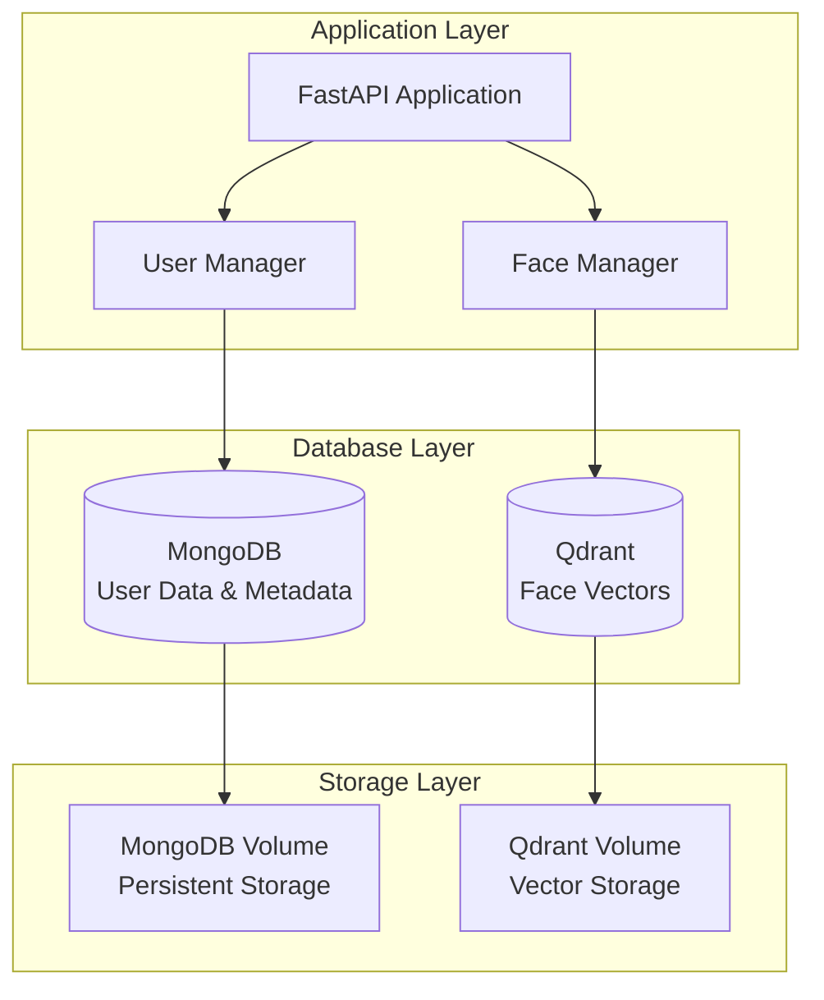

# 6. Cơ Sở Dữ Liệu

## 6.1 Tổng Quan Kiến Trúc Database

Hệ thống sử dụng kiến trúc dual-database để tối ưu hóa cho các nhu cầu khác nhau:

- **MongoDB**: Document database cho dữ liệu người dùng và metadata
- **Qdrant**: Vector database chuyên biệt cho similarity search



## 6.2 MongoDB Design

### 6.2.1 Database Configuration

```yaml
# MongoDB Configuration
version: "7.0"
storage_engine: "WiredTiger"
authentication: true
authorization: enabled

# Connection Settings
host: "localhost"
port: 27018
database: "face_attendance"
username: "admin"
password: "password123"

# Performance Settings
max_connections: 1000
cache_size_gb: 2
journal: true
oplog_size_mb: 1024
```

### 6.2.2 Collections Design

#### Users Collection

```javascript
// Collection: users
{
    // Primary key
    "_id": ObjectId("507f1f77bcf86cd799439011"),
    
    // User Information
    "name": "Nguyễn Văn An",
    "email": "nguyen.van.an@company.com",  // Unique index
    "phone": "+84901234567",
    "department": "Phòng Kỹ Thuật",
    "status": "active",  // active, inactive, deleted
    
    // Image Data (embedded documents)
    "images": [
        {
            "image_id": "550e8400-e29b-41d4-a716-446655440001",
            "full_image": "data:image/jpeg;base64,/9j/4AAQSkZJRgABAQAAAQ...",
            "thumbnail": "data:image/jpeg;base64,/9j/4AAQSkZJRgABAQAAAQ...",
            "face_vector_id": "face_vector_uuid_001",
            "created_at": ISODate("2024-01-15T08:30:00.000Z"),
            "quality_score": 0.85,
            "face_count": 1
        }
    ],
    
    // Timestamps
    "created_at": ISODate("2024-01-15T08:30:00.000Z"),
    "updated_at": ISODate("2024-01-15T08:30:00.000Z"),
    
    // Metadata for analytics
    "metadata": {
        "total_images": 2,
        "last_recognition": ISODate("2024-01-20T09:15:00.000Z"),
        "recognition_count": 45,
        "avg_confidence": 0.92,
        "last_login_ip": "192.168.1.100"
    },
    
    // Version for schema migration
    "_version": "2.0"
}
```

#### Attendance Logs Collection (Future)

```javascript
// Collection: attendance_logs
{
    "_id": ObjectId("507f1f77bcf86cd799439012"),
    "user_id": ObjectId("507f1f77bcf86cd799439011"),
    "timestamp": ISODate("2024-01-20T09:15:00.000Z"),
    "type": "check_in",  // check_in, check_out
    "confidence": 0.95,
    "location": {
        "device_id": "camera_001",
        "building": "Tòa nhà A",
        "floor": 3,
        "room": "Phòng 301"
    },
    "image_info": {
        "image_hash": "sha256_hash_of_image",
        "face_vector_id": "face_vector_uuid_001",
        "quality_score": 0.88
    },
    "status": "verified"  // verified, pending, rejected
}
```

#### System Configuration Collection

```javascript
// Collection: system_config
{
    "_id": ObjectId("507f1f77bcf86cd799439013"),
    "config_key": "face_recognition_settings",
    "config_value": {
        "similarity_threshold": 0.8,
        "max_images_per_user": 5,
        "image_quality_threshold": 0.7,
        "detection_confidence_threshold": 0.5
    },
    "created_at": ISODate("2024-01-15T08:30:00.000Z"),
    "updated_at": ISODate("2024-01-15T08:30:00.000Z"),
    "updated_by": "admin"
}
```

### 6.2.3 Indexing Strategy

```javascript
// Performance Indexes
db.users.createIndex({ "email": 1 }, { unique: true, background: true })
db.users.createIndex({ "name": 1 }, { background: true })
db.users.createIndex({ "department": 1 }, { background: true })
db.users.createIndex({ "status": 1 }, { background: true })
db.users.createIndex({ "created_at": -1 }, { background: true })
db.users.createIndex({ "updated_at": -1 }, { background: true })

// Compound Indexes for common queries
db.users.createIndex({ "status": 1, "department": 1 }, { background: true })
db.users.createIndex({ "status": 1, "created_at": -1 }, { background: true })

// Image-specific indexes
db.users.createIndex({ "images.image_id": 1 }, { background: true })
db.users.createIndex({ "images.face_vector_id": 1 }, { background: true })

// Text Search Index
db.users.createIndex({
    "name": "text",
    "email": "text", 
    "department": "text"
}, {
    weights: {
        "name": 10,
        "email": 5,
        "department": 1
    },
    name: "user_text_search"
})

// Attendance Logs Indexes (Future)
db.attendance_logs.createIndex({ "user_id": 1, "timestamp": -1 })
db.attendance_logs.createIndex({ "timestamp": -1 })
db.attendance_logs.createIndex({ "type": 1, "timestamp": -1 })
db.attendance_logs.createIndex({ "location.device_id": 1, "timestamp": -1 })

// TTL Index for old logs (optional)
db.attendance_logs.createIndex(
    { "timestamp": 1 }, 
    { expireAfterSeconds: 31536000 }  // 1 year
)
```

### 6.2.4 Data Validation Schema

```javascript
// MongoDB Schema Validation
db.createCollection("users", {
    validator: {
        $jsonSchema: {
            bsonType: "object",
            required: ["name", "email", "created_at", "updated_at", "status"],
            properties: {
                name: {
                    bsonType: "string",
                    minLength: 2,
                    maxLength: 100,
                    pattern: "^[a-zA-ZÀ-ỹ\\s]+$",
                    description: "Name must be 2-100 characters, letters and spaces only"
                },
                email: {
                    bsonType: "string",
                    pattern: "^[a-zA-Z0-9._%+-]+@[a-zA-Z0-9.-]+\\.[a-zA-Z]{2,}$",
                    description: "Must be a valid email address"
                },
                phone: {
                    bsonType: ["string", "null"],
                    maxLength: 20,
                    pattern: "^\\+?[0-9\\s\\-\\(\\)]+$",
                    description: "Valid phone number format"
                },
                department: {
                    bsonType: ["string", "null"],
                    maxLength: 100,
                    description: "Department name max 100 characters"
                },
                status: {
                    enum: ["active", "inactive", "deleted"],
                    description: "User status must be active, inactive, or deleted"
                },
                images: {
                    bsonType: "array",
                    maxItems: 5,
                    items: {
                        bsonType: "object",
                        required: ["image_id", "full_image", "thumbnail", "face_vector_id"],
                        properties: {
                            image_id: {
                                bsonType: "string",
                                pattern: "^[0-9a-f-]{36}$",
                                description: "Must be a valid UUID"
                            },
                            full_image: {
                                bsonType: "string",
                                minLength: 100,
                                description: "Base64 encoded image data"
                            },
                            thumbnail: {
                                bsonType: "string", 
                                minLength: 100,
                                description: "Base64 encoded thumbnail data"
                            },
                            face_vector_id: {
                                bsonType: "string",
                                minLength: 1,
                                description: "Reference to Qdrant vector ID"
                            },
                            quality_score: {
                                bsonType: "number",
                                minimum: 0,
                                maximum: 1,
                                description: "Image quality score 0-1"
                            }
                        }
                    }
                },
                metadata: {
                    bsonType: "object",
                    properties: {
                        total_images: {
                            bsonType: "int",
                            minimum: 0,
                            maximum: 5
                        },
                        recognition_count: {
                            bsonType: "int",
                            minimum: 0
                        },
                        avg_confidence: {
                            bsonType: "number",
                            minimum: 0,
                            maximum: 1
                        }
                    }
                }
            }
        }
    },
    validationLevel: "strict",
    validationAction: "error"
})
```

### 6.2.5 MongoDB Operations

```python
class MongoDBOperations:
    def __init__(self, connection_string: str, database_name: str):
        self.client = MongoClient(connection_string)
        self.db = self.client[database_name]
        self.users = self.db.users
        self.attendance_logs = self.db.attendance_logs
        self.system_config = self.db.system_config
    
    # User CRUD Operations
    def create_user(self, user_data: dict) -> str:
        """Create new user and return user ID"""
        
        # Add timestamps
        now = datetime.utcnow()
        user_data.update({
            "created_at": now,
            "updated_at": now,
            "status": "active",
            "_version": "2.0"
        })
        
        # Insert user
        result = self.users.insert_one(user_data)
        return str(result.inserted_id)
    
    def get_user_by_id(self, user_id: str) -> Optional[dict]:
        """Get user by ID"""
        try:
            return self.users.find_one({"_id": ObjectId(user_id)})
        except InvalidId:
            return None
    
    def get_user_by_email(self, email: str) -> Optional[dict]:
        """Get user by email"""
        return self.users.find_one({"email": email.lower()})
    
    def update_user(self, user_id: str, update_data: dict) -> bool:
        """Update user information"""
        
        # Add update timestamp
        update_data["updated_at"] = datetime.utcnow()
        
        result = self.users.update_one(
            {"_id": ObjectId(user_id)},
            {"$set": update_data}
        )
        return result.modified_count > 0
    
    def delete_user(self, user_id: str) -> bool:
        """Soft delete user (mark as deleted)"""
        
        result = self.users.update_one(
            {"_id": ObjectId(user_id)},
            {
                "$set": {
                    "status": "deleted",
                    "updated_at": datetime.utcnow()
                }
            }
        )
        return result.modified_count > 0
    
    def hard_delete_user(self, user_id: str) -> bool:
        """Permanently delete user"""
        
        result = self.users.delete_one({"_id": ObjectId(user_id)})
        return result.deleted_count > 0
    
    def get_all_users(self, status: str = "active", 
                     limit: int = 100, skip: int = 0) -> List[dict]:
        """Get all users with pagination"""
        
        query = {"status": status} if status else {}
        
        return list(self.users.find(query)
                   .sort("created_at", -1)
                   .limit(limit)
                   .skip(skip))
    
    def search_users(self, search_term: str, limit: int = 20) -> List[dict]:
        """Full-text search users"""
        
        return list(self.users.find(
            {
                "$text": {"$search": search_term},
                "status": "active"
            }
        ).limit(limit))
    
    # Image Operations
    def add_user_images(self, user_id: str, image_data: List[dict]) -> bool:
        """Add images to existing user"""
        
        result = self.users.update_one(
            {"_id": ObjectId(user_id)},
            {
                "$push": {"images": {"$each": image_data}},
                "$set": {"updated_at": datetime.utcnow()},
                "$inc": {"metadata.total_images": len(image_data)}
            }
        )
        return result.modified_count > 0
    
    def remove_user_image(self, user_id: str, image_id: str) -> bool:
        """Remove specific image from user"""
        
        result = self.users.update_one(
            {"_id": ObjectId(user_id)},
            {
                "$pull": {"images": {"image_id": image_id}},
                "$set": {"updated_at": datetime.utcnow()},
                "$inc": {"metadata.total_images": -1}
            }
        )
        return result.modified_count > 0
    
    # Analytics Operations
    def get_user_statistics(self) -> dict:
        """Get user statistics"""
        
        pipeline = [
            {
                "$group": {
                    "_id": "$status",
                    "count": {"$sum": 1},
                    "avg_images": {"$avg": {"$size": "$images"}},
                    "total_recognitions": {"$sum": "$metadata.recognition_count"}
                }
            }
        ]
        
        stats = list(self.users.aggregate(pipeline))
        
        return {
            "total_users": sum(stat["count"] for stat in stats),
            "by_status": {stat["_id"]: stat for stat in stats},
            "total_recognitions": sum(stat.get("total_recognitions", 0) for stat in stats)
        }
    
    def get_department_statistics(self) -> List[dict]:
        """Get statistics by department"""
        
        pipeline = [
            {"$match": {"status": "active"}},
            {
                "$group": {
                    "_id": "$department",
                    "user_count": {"$sum": 1},
                    "avg_images": {"$avg": {"$size": "$images"}},
                    "total_recognitions": {"$sum": "$metadata.recognition_count"}
                }
            },
            {"$sort": {"user_count": -1}}
        ]
        
        return list(self.users.aggregate(pipeline))
```

## 6.3 Qdrant Vector Database

### 6.3.1 Qdrant Configuration

```yaml
# Qdrant Configuration
version: "1.7.0"
host: "localhost"
port: 6333
grpc_port: 6334

# Storage Configuration
storage:
  storage_path: "/qdrant/storage"
  snapshots_path: "/qdrant/snapshots"
  temp_path: "/qdrant/temp"

# Performance Settings
service:
  max_request_size_mb: 32
  max_workers: 0  # Auto-detect CPU cores
  log_level: "INFO"

# Collection Settings
collection_config:
  name: "face_vectors"
  vector_size: 512
  distance: "Cosine"
  
# HNSW Index Configuration
hnsw_config:
  m: 16                    # Number of bi-directional links
  ef_construct: 200        # Size of dynamic candidate list during construction
  full_scan_threshold: 10000  # Threshold for switching to full scan
  max_indexing_threads: 0  # Auto-detect
```

### 6.3.2 Collection Schema

```python
# Qdrant Collection Configuration
from qdrant_client.models import Distance, VectorParams, OptimizersConfig

collection_config = {
    "collection_name": "face_vectors",
    "vectors_config": VectorParams(
        size=512,
        distance=Distance.COSINE
    ),
    "hnsw_config": {
        "m": 16,
        "ef_construct": 200,
        "full_scan_threshold": 10000,
        "max_indexing_threads": 0
    },
    "optimizers_config": OptimizersConfig(
        deleted_threshold=0.2,
        vacuum_min_vector_number=1000,
        default_segment_number=0,
        max_segment_size=None,
        memmap_threshold=None,
        indexing_threshold=20000,
        flush_interval_sec=5,
        max_optimization_threads=1
    )
}
```

### 6.3.3 Vector Point Structure

```python
# Qdrant Point Structure
{
    "id": "550e8400-e29b-41d4-a716-446655440001",  # UUID
    "vector": [
        0.1234, -0.5678, 0.9012, 0.3456, -0.7890,  # 512 float values
        # ... (507 more values)
    ],
    "payload": {
        # Core References
        "user_id": "507f1f77bcf86cd799439011",
        "image_id": "550e8400-e29b-41d4-a716-446655440001",
        
        # Timestamps
        "created_at": "2024-01-15T08:30:00.000Z",
        "updated_at": "2024-01-15T08:30:00.000Z",
        
        # Face Detection Info
        "face_bbox": {
            "x1": 120.5, "y1": 80.3,
            "x2": 220.7, "y2": 180.9,
            "confidence": 0.95,
            "width": 100.2, "height": 100.6
        },
        
        # Model Information
        "encoding_model": "facenet_vggface2",
        "model_version": "1.0.0",
        "detection_model": "yolov8n",
        
        # Quality Metrics
        "image_quality": {
            "brightness": 0.7,
            "contrast": 0.8,
            "sharpness": 0.9,
            "overall_score": 0.85
        },
        
        # Processing Metadata
        "processing_time_ms": 245,
        "face_size_pixels": 10020,
        "original_image_size": "1920x1080",
        
        # Business Metadata
        "department": "Phòng Kỹ Thuật",
        "status": "active",
        "tags": ["employee", "verified"]
    }
}
```

### 6.3.4 Qdrant Operations

```python
class QdrantOperations:
    def __init__(self, host: str = "localhost", port: int = 6333):
        self.client = QdrantClient(host=host, port=port)
        self.collection_name = "face_vectors"
        
        # Initialize collection if not exists
        self._ensure_collection_exists()
    
    def _ensure_collection_exists(self):
        """Create collection if it doesn't exist"""
        
        try:
            self.client.get_collection(self.collection_name)
        except Exception:
            # Collection doesn't exist, create it
            self.client.create_collection(
                collection_name=self.collection_name,
                vectors_config=VectorParams(size=512, distance=Distance.COSINE),
                hnsw_config=HnswConfig(
                    m=16,
                    ef_construct=200,
                    full_scan_threshold=10000
                ),
                optimizers_config=OptimizersConfig(
                    deleted_threshold=0.2,
                    vacuum_min_vector_number=1000,
                    indexing_threshold=20000,
                    flush_interval_sec=5
                )
            )
    
    def store_face_vector(self, vector_id: str, face_vector: np.ndarray, 
                         payload: dict) -> bool:
        """Store single face vector"""
        
        try:
            # Ensure vector is normalized
            if not np.allclose(np.linalg.norm(face_vector), 1.0):
                face_vector = face_vector / np.linalg.norm(face_vector)
            
            # Create point
            point = PointStruct(
                id=vector_id,
                vector=face_vector.tolist(),
                payload=payload
            )
            
            # Upsert point
            operation_info = self.client.upsert(
                collection_name=self.collection_name,
                points=[point]
            )
            
            return operation_info.status == "completed"
            
        except Exception as e:
            logger.error(f"Error storing face vector: {e}")
            return False
    
    def store_face_vectors_batch(self, vectors_data: List[dict]) -> bool:
        """Store multiple face vectors in batch"""
        
        try:
            points = []
            
            for data in vectors_data:
                vector = data["vector"]
                
                # Normalize vector
                if not np.allclose(np.linalg.norm(vector), 1.0):
                    vector = vector / np.linalg.norm(vector)
                
                points.append(PointStruct(
                    id=data["vector_id"],
                    vector=vector.tolist(),
                    payload=data["payload"]
                ))
            
            # Batch upsert
            operation_info = self.client.upsert(
                collection_name=self.collection_name,
                points=points
            )
            
            return operation_info.status == "completed"
            
        except Exception as e:
            logger.error(f"Error storing face vectors batch: {e}")
            return False
    
    def search_similar_faces(self, query_vector: np.ndarray, 
                           limit: int = 10, score_threshold: float = 0.8) -> List[dict]:
        """Search for similar face vectors"""
        
        try:
            # Normalize query vector
            if not np.allclose(np.linalg.norm(query_vector), 1.0):
                query_vector = query_vector / np.linalg.norm(query_vector)
            
            # Perform similarity search
            search_result = self.client.search(
                collection_name=self.collection_name,
                query_vector=query_vector.tolist(),
                limit=limit,
                score_threshold=score_threshold
            )
            
            # Format results
            results = []
            for hit in search_result:
                results.append({
                    "vector_id": str(hit.id),
                    "user_id": hit.payload.get("user_id"),
                    "image_id": hit.payload.get("image_id"),
                    "similarity_score": hit.score,
                    "payload": hit.payload
                })
            
            return results
            
        except Exception as e:
            logger.error(f"Error searching similar faces: {e}")
            return []
    
    def delete_user_vectors(self, user_id: str) -> bool:
        """Delete all vectors for a specific user"""
        
        try:
            # Delete vectors by user_id filter
            self.client.delete(
                collection_name=self.collection_name,
                points_selector=Filter(
                    must=[
                        FieldCondition(
                            key="user_id",
                            match=MatchValue(value=user_id)
                        )
                    ]
                )
            )
            
            return True
            
        except Exception as e:
            logger.error(f"Error deleting user vectors: {e}")
            return False
    
    def get_collection_stats(self) -> dict:
        """Get collection statistics"""
        
        try:
            collection_info = self.client.get_collection(self.collection_name)
            
            return {
                "total_vectors": collection_info.points_count,
                "vector_size": collection_info.config.params.vectors.size,
                "distance_metric": collection_info.config.params.vectors.distance,
                "indexed_vectors": collection_info.vectors_count,
                "status": collection_info.status
            }
            
        except Exception as e:
            logger.error(f"Error getting collection stats: {e}")
            return {}
```

## 6.4 Database Performance Optimization

### 6.4.1 MongoDB Performance Tuning

```javascript
// MongoDB Performance Configuration
{
    // WiredTiger Storage Engine Settings
    "storage": {
        "wiredTiger": {
            "engineConfig": {
                "cacheSizeGB": 2,
                "journalCompressor": "snappy",
                "directoryForIndexes": false
            },
            "collectionConfig": {
                "blockCompressor": "snappy"
            },
            "indexConfig": {
                "prefixCompression": true
            }
        }
    },
    
    // Connection Pool Settings
    "net": {
        "maxIncomingConnections": 1000,
        "maxConnectionIdleTime": 300000,
        "maxConnectionLifeTime": 600000
    },
    
    // Profiling Settings
    "operationProfiling": {
        "mode": "slowOp",
        "slowOpThresholdMs": 100
    }
}
```

### 6.4.2 Query Optimization Strategies

```python
class OptimizedQueries:
    """Optimized database queries for better performance"""
    
    def __init__(self, db_connection):
        self.db = db_connection
    
    def get_users_with_pagination(self, page: int = 1, page_size: int = 20, 
                                 department: str = None, status: str = "active") -> dict:
        """Optimized user listing with pagination and filtering"""
        
        # Build query filter
        query_filter = {"status": status}
        if department:
            query_filter["department"] = department
        
        # Calculate skip value
        skip = (page - 1) * page_size
        
        # Execute query with projection to exclude large image data
        cursor = self.db.users.find(
            query_filter,
            {
                "name": 1,
                "email": 1,
                "department": 1,
                "phone": 1,
                "created_at": 1,
                "updated_at": 1,
                "metadata.total_images": 1,
                "metadata.last_recognition": 1,
                "images": {"$slice": 1}  # Only get first image for thumbnail
            }
        ).sort("created_at", -1).skip(skip).limit(page_size)
        
        users = list(cursor)
        
        # Get total count for pagination
        total_count = self.db.users.count_documents(query_filter)
        
        return {
            "users": users,
            "pagination": {
                "current_page": page,
                "page_size": page_size,
                "total_count": total_count,
                "total_pages": (total_count + page_size - 1) // page_size
            }
        }
    
    def search_users_optimized(self, search_term: str, limit: int = 20) -> List[dict]:
        """Optimized user search using text index"""
        
        # Use text search with score sorting
        pipeline = [
            {
                "$match": {
                    "$text": {"$search": search_term},
                    "status": "active"
                }
            },
            {
                "$addFields": {
                    "score": {"$meta": "textScore"}
                }
            },
            {
                "$sort": {"score": {"$meta": "textScore"}}
            },
            {
                "$limit": limit
            },
            {
                "$project": {
                    "name": 1,
                    "email": 1,
                    "department": 1,
                    "phone": 1,
                    "created_at": 1,
                    "metadata.total_images": 1,
                    "score": 1,
                    "images": {"$slice": ["$images", 1]}  # Only first image
                }
            }
        ]
        
        return list(self.db.users.aggregate(pipeline))
    
    def get_user_analytics_dashboard(self) -> dict:
        """Get analytics data for dashboard with single aggregation"""
        
        pipeline = [
            {
                "$facet": {
                    # User statistics by status
                    "user_stats": [
                        {
                            "$group": {
                                "_id": "$status",
                                "count": {"$sum": 1},
                                "avg_images": {"$avg": {"$size": "$images"}},
                                "total_recognitions": {"$sum": "$metadata.recognition_count"}
                            }
                        }
                    ],
                    
                    # Department statistics
                    "department_stats": [
                        {"$match": {"status": "active"}},
                        {
                            "$group": {
                                "_id": "$department",
                                "user_count": {"$sum": 1},
                                "avg_images": {"$avg": {"$size": "$images"}},
                                "total_recognitions": {"$sum": "$metadata.recognition_count"}
                            }
                        },
                        {"$sort": {"user_count": -1}},
                        {"$limit": 10}
                    ],
                    
                    # Recent activity
                    "recent_users": [
                        {"$match": {"status": "active"}},
                        {"$sort": {"created_at": -1}},
                        {"$limit": 5},
                        {
                            "$project": {
                                "name": 1,
                                "email": 1,
                                "department": 1,
                                "created_at": 1,
                                "metadata.total_images": 1
                            }
                        }
                    ],
                    
                    # Image quality statistics
                    "image_quality_stats": [
                        {"$unwind": "$images"},
                        {
                            "$group": {
                                "_id": None,
                                "avg_quality": {"$avg": "$images.quality_score"},
                                "min_quality": {"$min": "$images.quality_score"},
                                "max_quality": {"$max": "$images.quality_score"},
                                "total_images": {"$sum": 1}
                            }
                        }
                    ]
                }
            }
        ]
        
        result = list(self.db.users.aggregate(pipeline))[0]
        
        return {
            "user_statistics": result["user_stats"],
            "department_statistics": result["department_stats"],
            "recent_users": result["recent_users"],
            "image_quality": result["image_quality_stats"][0] if result["image_quality_stats"] else {}
        }
```

### 6.4.3 Qdrant Performance Optimization

```python
class OptimizedQdrantOperations:
    """Optimized Qdrant operations for better performance"""
    
    def __init__(self, client, collection_name):
        self.client = client
        self.collection_name = collection_name
    
    def batch_similarity_search(self, query_vectors: List[np.ndarray], 
                              limit: int = 10, score_threshold: float = 0.8) -> List[List[dict]]:
        """Batch similarity search for multiple query vectors"""
        
        try:
            # Normalize all query vectors
            normalized_vectors = []
            for vector in query_vectors:
                if not np.allclose(np.linalg.norm(vector), 1.0):
                    vector = vector / np.linalg.norm(vector)
                normalized_vectors.append(vector.tolist())
            
            # Perform batch search
            search_results = self.client.search_batch(
                collection_name=self.collection_name,
                requests=[
                    SearchRequest(
                        vector=vector,
                        limit=limit,
                        score_threshold=score_threshold
                    ) for vector in normalized_vectors
                ]
            )
            
            # Format results
            batch_results = []
            for search_result in search_results:
                results = []
                for hit in search_result:
                    results.append({
                        "vector_id": str(hit.id),
                        "user_id": hit.payload.get("user_id"),
                        "image_id": hit.payload.get("image_id"),
                        "similarity_score": hit.score,
                        "payload": hit.payload
                    })
                batch_results.append(results)
            
            return batch_results
            
        except Exception as e:
            logger.error(f"Error in batch similarity search: {e}")
            return []
    
    def get_user_vector_statistics(self, user_id: str) -> dict:
        """Get statistics for user's face vectors"""
        
        try:
            # Get all vectors for user
            scroll_result = self.client.scroll(
                collection_name=self.collection_name,
                scroll_filter=Filter(
                    must=[
                        FieldCondition(
                            key="user_id",
                            match=MatchValue(value=user_id)
                        )
                    ]
                ),
                limit=100,
                with_vectors=True
            )
            
            vectors = scroll_result[0]
            
            if not vectors:
                return {"vector_count": 0}
            
            # Calculate statistics
            vector_arrays = [np.array(point.vector) for point in vectors]
            
            # Calculate pairwise similarities within user's vectors
            similarities = []
            for i in range(len(vector_arrays)):
                for j in range(i + 1, len(vector_arrays)):
                    similarity = np.dot(vector_arrays[i], vector_arrays[j])
                    similarities.append(similarity)
            
            stats = {
                "vector_count": len(vectors),
                "avg_internal_similarity": np.mean(similarities) if similarities else 0,
                "min_internal_similarity": np.min(similarities) if similarities else 0,
                "max_internal_similarity": np.max(similarities) if similarities else 0,
                "std_internal_similarity": np.std(similarities) if similarities else 0,
                "image_ids": [point.payload.get("image_id") for point in vectors],
                "creation_dates": [point.payload.get("created_at") for point in vectors]
            }
            
            return stats
            
        except Exception as e:
            logger.error(f"Error getting user vector statistics: {e}")
            return {"error": str(e)}
```

## 6.5 Database Backup and Recovery

### 6.5.1 MongoDB Backup Strategy

```bash
#!/bin/bash
# MongoDB Backup Script

# Configuration
MONGODB_HOST="localhost"
MONGODB_PORT="27018"
MONGODB_USERNAME="admin"
MONGODB_PASSWORD="password123"
DATABASE_NAME="face_attendance"
BACKUP_DIR="/backup/mongodb"
DATE=$(date +%Y%m%d_%H%M%S)

# Create backup directory
mkdir -p $BACKUP_DIR/$DATE

# Full database backup
mongodump \
    --host $MONGODB_HOST:$MONGODB_PORT \
    --username $MONGODB_USERNAME \
    --password $MONGODB_PASSWORD \
    --db $DATABASE_NAME \
    --out $BACKUP_DIR/$DATE

# Compress backup
tar -czf $BACKUP_DIR/mongodb_backup_$DATE.tar.gz -C $BACKUP_DIR $DATE

# Remove uncompressed backup
rm -rf $BACKUP_DIR/$DATE

# Keep only last 7 days of backups
find $BACKUP_DIR -name "mongodb_backup_*.tar.gz" -mtime +7 -delete

echo "MongoDB backup completed: mongodb_backup_$DATE.tar.gz"
```

### 6.5.2 Qdrant Backup Strategy

```bash
#!/bin/bash
# Qdrant Backup Script

# Configuration
QDRANT_HOST="localhost"
QDRANT_PORT="6333"
COLLECTION_NAME="face_vectors"
BACKUP_DIR="/backup/qdrant"
DATE=$(date +%Y%m%d_%H%M%S)

# Create backup directory
mkdir -p $BACKUP_DIR/$DATE

# Create collection snapshot
curl -X POST "http://$QDRANT_HOST:$QDRANT_PORT/collections/$COLLECTION_NAME/snapshots" \
    -H "Content-Type: application/json"

# Wait for snapshot creation
sleep 5

# Download snapshot
SNAPSHOT_NAME=$(curl -s "http://$QDRANT_HOST:$QDRANT_PORT/collections/$COLLECTION_NAME/snapshots" | \
    jq -r '.result[-1].name')

curl -X GET "http://$QDRANT_HOST:$QDRANT_PORT/collections/$COLLECTION_NAME/snapshots/$SNAPSHOT_NAME" \
    --output $BACKUP_DIR/$DATE/qdrant_snapshot_$DATE.snapshot

# Compress backup
tar -czf $BACKUP_DIR/qdrant_backup_$DATE.tar.gz -C $BACKUP_DIR $DATE

# Remove uncompressed backup
rm -rf $BACKUP_DIR/$DATE

# Keep only last 7 days of backups
find $BACKUP_DIR -name "qdrant_backup_*.tar.gz" -mtime +7 -delete

echo "Qdrant backup completed: qdrant_backup_$DATE.tar.gz"
```

### 6.5.3 Automated Backup Cron Jobs

```bash
# Add to crontab (crontab -e)

# MongoDB backup every day at 2 AM
0 2 * * * /path/to/mongodb_backup.sh >> /var/log/mongodb_backup.log 2>&1

# Qdrant backup every day at 3 AM
0 3 * * * /path/to/qdrant_backup.sh >> /var/log/qdrant_backup.log 2>&1

# Weekly full system backup (Sunday at 1 AM)
0 1 * * 0 /path/to/full_system_backup.sh >> /var/log/full_backup.log 2>&1
```

## 6.6 Database Monitoring and Maintenance

### 6.6.1 MongoDB Monitoring

```python
class MongoDBMonitor:
    """MongoDB monitoring and health check utilities"""
    
    def __init__(self, db_connection):
        self.db = db_connection
    
    def get_database_stats(self) -> dict:
        """Get comprehensive database statistics"""
        
        try:
            # Database stats
            db_stats = self.db.command("dbStats")
            
            # Collection stats
            collection_stats = {}
            for collection_name in self.db.list_collection_names():
                collection_stats[collection_name] = self.db.command("collStats", collection_name)
            
            # Server status
            server_status = self.db.command("serverStatus")
            
            return {
                "database_stats": {
                    "collections": db_stats.get("collections", 0),
                    "objects": db_stats.get("objects", 0),
                    "data_size_mb": db_stats.get("dataSize", 0) / (1024 * 1024),
                    "storage_size_mb": db_stats.get("storageSize", 0) / (1024 * 1024),
                    "index_size_mb": db_stats.get("indexSize", 0) / (1024 * 1024)
                },
                "collection_stats": collection_stats,
                "server_info": {
                    "version": server_status.get("version"),
                    "uptime_seconds": server_status.get("uptime"),
                    "connections": server_status.get("connections", {}),
                    "memory": server_status.get("mem", {}),
                    "network": server_status.get("network", {})
                }
            }
            
        except Exception as e:
            logger.error(f"Error getting database stats: {e}")
            return {"error": str(e)}
    
    def check_slow_queries(self, threshold_ms: int = 100) -> List[dict]:
        """Check for slow queries in the profiler collection"""
        
        try:
            # Enable profiling if not already enabled
            self.db.set_profiling_level(1, slow_ms=threshold_ms)
            
            # Get slow operations from profiler
            slow_ops = list(self.db.system.profile.find({
                "ts": {"$gte": datetime.utcnow() - timedelta(hours=1)},
                "millis": {"$gte": threshold_ms}
            }).sort("ts", -1).limit(50))
            
            return slow_ops
            
        except Exception as e:
            logger.error(f"Error checking slow queries: {e}")
            return []
    
    def get_index_usage_stats(self) -> dict:
        """Get index usage statistics for optimization"""
        
        try:
            stats = {}
            
            for collection_name in self.db.list_collection_names():
                collection = self.db[collection_name]
                
                # Get index stats
                index_stats = list(collection.aggregate([
                    {"$indexStats": {}}
                ]))
                
                stats[collection_name] = index_stats
            
            return stats
            
        except Exception as e:
            logger.error(f"Error getting index usage stats: {e}")
            return {}
```

### 6.6.2 Qdrant Monitoring

```python
class QdrantMonitor:
    """Qdrant monitoring and health check utilities"""
    
    def __init__(self, client, collection_name):
        self.client = client
        self.collection_name = collection_name
    
    def get_cluster_info(self) -> dict:
        """Get Qdrant cluster information"""
        
        try:
            # Get cluster info
            cluster_info = self.client.get_cluster_info()
            
            # Get collection info
            collection_info = self.client.get_collection(self.collection_name)
            
            # Get collection aliases
            aliases = self.client.get_collection_aliases(self.collection_name)
            
            return {
                "cluster_info": cluster_info,
                "collection_info": {
                    "status": collection_info.status,
                    "points_count": collection_info.points_count,
                    "vectors_count": collection_info.vectors_count,
                    "indexed_vectors_count": collection_info.indexed_vectors_count,
                    "config": collection_info.config.dict()
                },
                "aliases": aliases
            }
            
        except Exception as e:
            logger.error(f"Error getting Qdrant cluster info: {e}")
            return {"error": str(e)}
    
    def check_collection_health(self) -> dict:
        """Check collection health and performance metrics"""
        
        try:
            # Get collection info
            collection_info = self.client.get_collection(self.collection_name)
            
            # Calculate health metrics
            total_points = collection_info.points_count
            indexed_points = collection_info.indexed_vectors_count
            indexing_ratio = indexed_points / total_points if total_points > 0 else 0
            
            # Check if collection is healthy
            is_healthy = (
                collection_info.status == "green" and
                indexing_ratio > 0.95  # At least 95% of vectors should be indexed
            )
            
            return {
                "is_healthy": is_healthy,
                "status": collection_info.status,
                "total_points": total_points,
                "indexed_points": indexed_points,
                "indexing_ratio": indexing_ratio,
                "recommendations": self._get_health_recommendations(collection_info, indexing_ratio)
            }
            
        except Exception as e:
            logger.error(f"Error checking collection health: {e}")
            return {"error": str(e)}
    
    def _get_health_recommendations(self, collection_info, indexing_ratio: float) -> List[str]:
        """Get health recommendations based on collection status"""
        
        recommendations = []
        
        if collection_info.status != "green":
            recommendations.append("Collection status is not green. Check for errors or ongoing operations.")
        
        if indexing_ratio < 0.95:
            recommendations.append("Low indexing ratio. Consider waiting for indexing to complete or check for issues.")
        
        if collection_info.points_count > 1000000:
            recommendations.append("Large collection detected. Consider optimizing HNSW parameters for better performance.")
        
        return recommendations
```

## 6.7 Database Security

### 6.7.1 MongoDB Security Configuration

```javascript
// MongoDB Security Settings
{
    // Authentication
    "security": {
        "authorization": "enabled",
        "authentication": "enabled"
    },
    
    // Network Security
    "net": {
        "bindIp": "127.0.0.1,192.168.1.100",  // Restrict access
        "port": 27018,  // Non-default port
        "ssl": {
            "mode": "requireSSL",
            "PEMKeyFile": "/etc/ssl/mongodb.pem",
            "CAFile": "/etc/ssl/ca.pem"
        }
    },
    
    // Audit Logging
    "auditLog": {
        "destination": "file",
        "format": "JSON",
        "path": "/var/log/mongodb/audit.log",
        "filter": {
            "atype": {
                "$in": ["authenticate", "authCheck", "createUser", "dropUser"]
            }
        }
    }
}
```

### 6.7.2 User Roles and Permissions

```javascript
// Create application user with limited permissions
use face_attendance

db.createUser({
    user: "face_app_user",
    pwd: "secure_app_password_123",
    roles: [
        {
            role: "readWrite",
            db: "face_attendance"
        }
    ]
})

// Create read-only user for analytics
db.createUser({
    user: "analytics_user",
    pwd: "analytics_password_123",
    roles: [
        {
            role: "read",
            db: "face_attendance"
        }
    ]
})

// Create backup user
db.createUser({
    user: "backup_user",
    pwd: "backup_password_123",
    roles: [
        {
            role: "backup",
            db: "admin"
        },
        {
            role: "read",
            db: "face_attendance"
        }
    ]
})
```

### 6.7.3 Data Encryption and Privacy

```python
class DataEncryption:
    """Data encryption utilities for sensitive information"""
    
    def __init__(self, encryption_key: str):
        from cryptography.fernet import Fernet
        self.cipher = Fernet(encryption_key.encode())
    
    def encrypt_sensitive_data(self, data: str) -> str:
        """Encrypt sensitive data like phone numbers"""
        return self.cipher.encrypt(data.encode()).decode()
    
    def decrypt_sensitive_data(self, encrypted_data: str) -> str:
        """Decrypt sensitive data"""
        return self.cipher.decrypt(encrypted_data.encode()).decode()
    
    def hash_email(self, email: str) -> str:
        """Create searchable hash of email for privacy"""
        import hashlib
        return hashlib.sha256(email.lower().encode()).hexdigest()
```

## 6.8 Kết Luận

Hệ thống cơ sở dữ liệu của Face Attendance System được thiết kế với kiến trúc dual-database để tối ưu hóa cho các nhu cầu khác nhau:

### 6.8.1 Ưu Điểm Của Kiến Trúc

- **MongoDB**: Xử lý hiệu quả dữ liệu người dùng và metadata với khả năng mở rộng cao
- **Qdrant**: Tối ưu hóa cho similarity search với hiệu suất cao và độ chính xác tốt
- **Tách biệt trách nhiệm**: Mỗi database đảm nhận vai trò phù hợp với đặc thù dữ liệu
- **Khả năng mở rộng**: Có thể scale độc lập theo nhu cầu từng loại dữ liệu

### 6.8.2 Tính Năng Nổi Bật

- **Retry Logic**: Xử lý lỗi kết nối và tự động thử lại
- **Connection Pooling**: Quản lý kết nối hiệu quả
- **Indexing Strategy**: Tối ưu hóa truy vấn với các index phù hợp
- **Backup & Recovery**: Chiến lược sao lưu tự động và khôi phục
- **Monitoring**: Giám sát hiệu suất và sức khỏe hệ thống
- **Security**: Bảo mật đa lớp với authentication, authorization và encryption

### 6.8.3 Khuyến Nghị Vận Hành

1. **Monitoring thường xuyên**: Theo dõi hiệu suất và dung lượng
2. **Backup định kỳ**: Thực hiện sao lưu hàng ngày
3. **Index optimization**: Tối ưu hóa index dựa trên usage statistics
4. **Security updates**: Cập nhật bảo mật thường xuyên
5. **Capacity planning**: Lập kế hoạch mở rộng dựa trên growth metrics