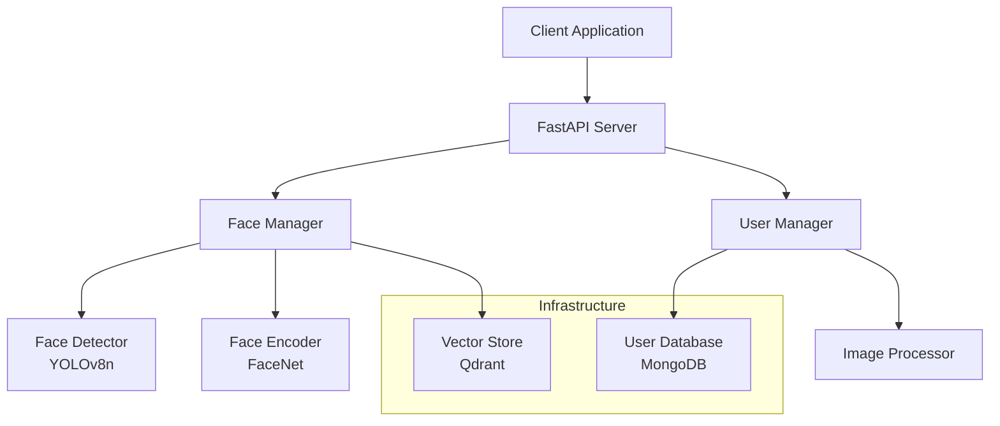

# Design Document: Face Attendance System

## Overview

Hệ thống điểm danh khuôn mặt được thiết kế theo kiến trúc microservice với các thành phần chính: Face Detection (YOLO), Face Recognition (FaceNet), User Management, và hai database (MongoDB và Qdrant). Hệ thống cung cấp REST API để tương tác và được deploy bằng Docker Compose.

## Architecture



## Components and Interfaces

### 1. FastAPI Server
**Responsibility**: Cung cấp REST API endpoints và xử lý HTTP requests

**Interfaces**:
```python
class FaceAttendanceAPI:
    def search_face(image: UploadFile) -> UserSearchResult
    def get_users() -> List[UserInfo]
    def create_user(user_data: UserCreate, images: List[UploadFile]) -> UserInfo
    def update_user(user_id: str, user_data: UserUpdate) -> UserInfo
    def delete_user(user_id: str) -> bool
```

### 2. Face Manager
**Responsibility**: Xử lý detection, encoding và tìm kiếm khuôn mặt

**Interfaces**:
```python
class FaceManager:
    def detect_faces(image: np.ndarray) -> List[BoundingBox]
    def encode_face(face_image: np.ndarray) -> np.ndarray
    def search_similar_face(face_vector: np.ndarray, threshold: float = 0.8) -> Optional[str]
    def store_face_vector(user_id: str, face_vector: np.ndarray) -> bool
    def delete_user_vectors(user_id: str) -> bool
```

### 3. User Manager
**Responsibility**: Quản lý thông tin người dùng và hình ảnh

**Interfaces**:
```python
class UserManager:
    def create_user(user_data: UserCreate, images: List[bytes]) -> UserInfo
    def get_user(user_id: str) -> Optional[UserInfo]
    def get_all_users() -> List[UserInfo]
    def update_user(user_id: str, user_data: UserUpdate) -> UserInfo
    def delete_user(user_id: str) -> bool
    def validate_image_limit(user_id: str, new_images_count: int) -> bool
```

### 4. Image Processor
**Responsibility**: Xử lý và resize hình ảnh

**Interfaces**:
```python
class ImageProcessor:
    def resize_image(image: bytes, width: int) -> bytes
    def create_thumbnail(image: bytes, size: Tuple[int, int]) -> bytes
    def encode_base64(image: bytes) -> str
    def decode_base64(encoded: str) -> bytes
```

## Data Models

### User Information (MongoDB)
```python
class UserInfo:
    id: str
    name: str
    email: str
    phone: Optional[str]
    department: Optional[str]
    images: List[ImageData]  # Tối đa 5 hình
    created_at: datetime
    updated_at: datetime

class ImageData:
    image_id: str
    full_image: str  # base64, width=600px
    thumbnail: str   # base64, 150x150px
    face_vector_id: str  # Reference to Qdrant
```

### Face Vector (Qdrant)
```python
class FaceVector:
    id: str
    vector: List[float]  # 512 dimensions from FaceNet
    payload: {
        "user_id": str,
        "image_id": str,
        "created_at": str
    }
```

## Correctness Properties

*A property is a characteristic or behavior that should hold true across all valid executions of a system-essentially, a formal statement about what the system should do. Properties serve as the bridge between human-readable specifications and machine-verifiable correctness guarantees.*

### Core Properties

Property 1: Face detection consistency
*For any* valid image containing faces, the Face_Detector should detect at least one face and return valid bounding box coordinates
**Validates: Requirements 1.1**

Property 2: Face encoding dimension consistency
*For any* detected face image, the Face_Encoder should generate a vector of exactly 512 dimensions
**Validates: Requirements 1.2**

Property 3: Comprehensive face search
*For any* face vector search, the Vector_Store should compare against all stored vectors for all users in the database
**Validates: Requirements 1.3**

Property 4: Similarity threshold matching
*For any* face comparison, when the highest similarity score is above 0.8, the system should return a match, and when below 0.8, should return no match
**Validates: Requirements 1.4**

Property 5: User creation completeness
*For any* valid user data and images, creating a user should store information in MongoDB and all face vectors in Qdrant
**Validates: Requirements 2.1**

Property 6: Image limit enforcement
*For any* user, the system should accept up to 5 images and reject any additional images beyond this limit
**Validates: Requirements 2.2**

Property 7: Update preservation
*For any* user information update, the operation should modify user data while preserving all existing face vectors unchanged
**Validates: Requirements 2.4**

Property 8: Complete deletion
*For any* user deletion, the operation should remove all user information from MongoDB and all associated face vectors from Qdrant
**Validates: Requirements 2.5**

Property 9: Complete user listing
*For any* user list request, the response should include all users with their complete information and all thumbnail images
**Validates: Requirements 2.6**

Property 10: Input validation
*For any* invalid user data, the system should reject the operation and return descriptive validation errors
**Validates: Requirements 2.7**

Property 11: API search functionality
*For any* image submitted to POST /search endpoint, the API should return matching user information when a face match is found
**Validates: Requirements 3.1**

Property 12: API user listing
*For any* GET /users request, the API should return all users with their thumbnail images
**Validates: Requirements 3.2**

Property 13: API user creation
*For any* valid user data and images submitted to POST /users, the API should successfully create a new user
**Validates: Requirements 3.3**

Property 14: API user update
*For any* valid update data submitted to PUT /users/{id}, the API should successfully update the existing user
**Validates: Requirements 3.4**

Property 15: API user deletion
*For any* valid user ID submitted to DELETE /users/{id}, the API should successfully remove the user from the system
**Validates: Requirements 3.5**

Property 16: MongoDB persistence
*For any* user data stored in MongoDB, the data should persist correctly with support for multiple images per user
**Validates: Requirements 4.1**

Property 17: Qdrant vector indexing
*For any* face vectors stored in Qdrant, multiple vectors per user should be indexed correctly for comprehensive matching
**Validates: Requirements 4.2**

Property 18: Database error handling
*For any* database operation failure, the system should handle errors gracefully and attempt connection recovery
**Validates: Requirements 4.5**

Property 19: Face cropping consistency
*For any* detected face, the cropping operation should produce properly padded face images with consistent dimensions
**Validates: Requirements 6.1**

Property 20: Image resizing consistency
*For any* user image, the storage operation should resize it to exactly 600 pixels width while maintaining aspect ratio
**Validates: Requirements 6.2**

Property 21: Thumbnail generation consistency
*For any* user image, the thumbnail generation should produce exactly 150x150 pixel images
**Validates: Requirements 6.3**

Property 22: Face normalization
*For any* face image before encoding, the preprocessing should normalize the image to standard format
**Validates: Requirements 6.4**

Property 23: Base64 storage format
*For any* stored image, both full images and thumbnails should be saved in valid base64 format that can be decoded
**Validates: Requirements 6.5**

Property 24: Unsupported format handling
*For any* unsupported image format, the system should return appropriate format error messages
**Validates: Requirements 6.6**

## Error Handling

### Face Detection Errors
- **No face detected**: Return structured error with message "No face detected in image"
- **Multiple faces**: Process all detected faces, store vectors for each
- **Low quality image**: Return error with quality improvement suggestions

### User Management Errors
- **Duplicate user**: Return error with existing user information
- **Image limit exceeded**: Return error "Maximum 5 images per user allowed"
- **Invalid user data**: Return validation errors with specific field issues
- **User not found**: Return 404 error with user ID

### Database Errors
- **Connection failure**: Implement retry logic with exponential backoff
- **Storage failure**: Return error and maintain data consistency
- **Query timeout**: Return timeout error and suggest retry

### API Errors
- **Invalid request format**: Return 400 with format requirements
- **Authentication failure**: Return 401 with authentication requirements
- **Server errors**: Return 500 with generic error message, log details

## Testing Strategy

### Dual Testing Approach
The system will use both unit testing and property-based testing for comprehensive coverage:

**Unit Tests**:
- Test specific examples and edge cases
- Validate integration points between components
- Test error conditions and boundary values
- Focus on concrete scenarios and known inputs

**Property-Based Tests**:
- Verify universal properties across all inputs
- Test with randomly generated valid data
- Ensure correctness properties hold for large input spaces
- Minimum 100 iterations per property test

### Property-Based Testing Configuration
- **Framework**: Use `hypothesis` for Python property-based testing
- **Test Configuration**: Each property test runs minimum 100 iterations
- **Test Tagging**: Each test references its design document property
- **Tag Format**: `# Feature: face-attendance-system, Property {number}: {property_text}`

### Testing Components

**Face Detection Testing**:
- Unit tests: Test with known face images, no-face images, multiple faces
- Property tests: Test face detection consistency across random valid images

**Face Recognition Testing**:
- Unit tests: Test with known face pairs, similarity thresholds
- Property tests: Test encoding consistency and similarity calculations

**User Management Testing**:
- Unit tests: Test CRUD operations with specific data
- Property tests: Test data integrity across random user operations

**API Testing**:
- Unit tests: Test specific endpoint behaviors and error cases
- Property tests: Test API consistency across random valid requests

**Database Testing**:
- Unit tests: Test connection handling and specific queries
- Property tests: Test data persistence and retrieval consistency

### Test Data Management
- Use Docker containers for test databases
- Generate realistic test images for face detection
- Create user data generators for property tests
- Implement cleanup procedures for test isolation